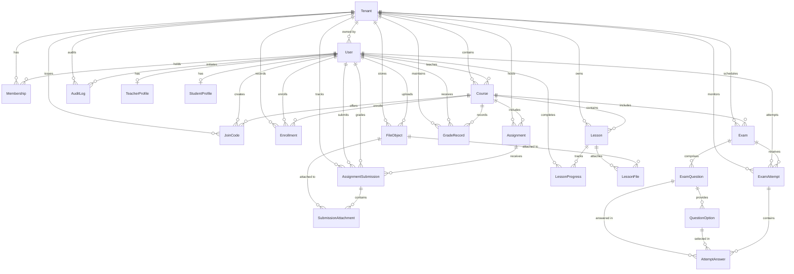

# DARB — Data Model & Schema Specification

This document details the complete 22-entity MVP domain model, entity relationships, database constraints, PostgreSQL migration history, and tenant ownership boundaries.

---

## 1. Domain Entity Relationship Diagram

---

## 2. Entity Dictionary & Ownership Rules

### 2.1 Core Tenancy & Identity
- **`Tenant`**: Represents an isolated workspace / academy owned by a teacher (`ownerId`). Has a unique `slug`.
- **`User`**: System identity. Can have roles `ADMIN`, `TEACHER`, or `STUDENT`.
  - `username` is unique and the primary login identifier.
  - `email` is **optional and nullable** (`email String? @unique`), specifically accommodating students without personal emails.
  - `passwordHash` stores the Argon2id hash.
  - `failedLoginAttempts` and `lockedUntil` track brute force mitigation.
- **`Membership`**: Links a `User` to a `Tenant` with a role (`ADMIN`, `TEACHER`, `STUDENT`). Unique constraint on `[tenantId, userId]`. Supports future multi-tenant users.
- **`TeacherProfile`**: Bio, specialization, phone (`userId` unique FK).
- **`StudentProfile`**: Grade level, parent phone, national/student ID number (`userId` unique FK).

### 2.2 Courses & Enrollment
- **`Course`**: Belongs to exactly one `Tenant` (`tenantId`). Taught by a teacher (`teacherId`).
- **`JoinCode`**: Teacher-generated access token to enroll in a course.
  - `codeHash` is a unique SHA-256 hash. The plaintext code is never stored.
  - `codeHint` (e.g. `PHY-***`) allows display without exposing the secret.
  - Supports `expiresAt`, `maxUses`, and `currentUses`.
- **`Enrollment`**: Associates a student with a course. Unique constraint on `[courseId, studentId]`, preventing duplicate active enrollments.

### 2.3 Content & Storage
- **`Lesson`**: Educational module in a course with ordering (`orderIndex`) and draft/published state (`isPublished`).
- **`FileObject`**: Metadata record for files stored in S3/R2. Tracks `storageKey`, `byteSize`, `mimeType`, and `isPublic`.
- **`LessonFile`**: Join table attaching a `FileObject` to a `Lesson`. Unique on `[lessonId, fileId]`.
- **`LessonProgress`**: Tracks student completion of a lesson. Unique on `[lessonId, studentId]`.

### 2.4 Assignments & Grading
- **`Assignment`**: Homework/worksheet with `maxScore` (default 100) and `dueDate`.
- **`AssignmentSubmission`**: Student submission with `textContent`, status (`SUBMITTED`, `GRADED`, `LATE`), numerical `score`, and teacher `feedback`. Unique on `[assignmentId, studentId]`.
- **`SubmissionAttachment`**: Join table attaching submitted files (`FileObject`) to a submission.
- **`GradeRecord`**: Unified grade ledger recording assignment and exam outcomes. Unique on `[courseId, studentId, itemType, itemId]`.

### 2.5 Multiple-Choice Exams
- **`Exam`**: Timed assessment with `durationMinutes`, `maxAttempts`, `passingScore`, and hard cut-off timestamps (`startsAt`, `endsAt`).
- **`ExamQuestion`**: Question prompt, type (`MULTIPLE_CHOICE`, `TRUE_FALSE`), and point value.
- **`QuestionOption`**: Answer option. `isCorrect` boolean is withheld from students during active attempts.
- **`ExamAttempt`**: Student exam session tracking `startedAt`, `submittedAt`, and server-enforced `deadlineAt`. Unique on `[examId, studentId, attemptNumber]`.
- **`AttemptAnswer`**: Individual answer choice saved during attempt. Supports auto-grading.

### 2.6 Audit
- **`AuditLog`**: System security and administrative event ledger tracking `action` (`USER_LOGIN`, `USER_LOGOUT`, `PASSWORD_RESET`, etc.), `actorId`, `tenantId`, `ipAddress`, and `details` JSON.

---

## 3. Database Constraints & Indexing Strategy

1. **Primary Keys**: RFC 4122 UUID identifiers (`@id @default(uuid()) @db.Uuid`).
2. **Timestamps**: All temporal columns use PostgreSQL `timestamptz(6)` to eliminate timezone ambiguity.
3. **Soft Deletions**: Important educational entities (`Course`, `Lesson`, `Assignment`, `Exam`, `Enrollment`, `FileObject`, `User`, `Tenant`) include `deletedAt DateTime? @db.Timestamptz(6)` to prevent destructive loss of student academic history.
4. **Foreign Keys**: Explicit Prisma relations with `onDelete: Cascade` for child components (e.g. `QuestionOption`, `AttemptAnswer`) and `SetNull` for audit references.
5. **Indexes**:
   - Every tenant-owned table is indexed on `tenantId` to accelerate PostgreSQL RLS filtering.
   - User lookups are indexed on `username`.
   - Unique constraints guard against duplicate memberships, enrollments, and submissions.

---

## 4. Migration History

| Migration Identifier | Name | Scope & Changes |
|---|---|---|
| `20261029092508_init_darb_mvp` | `init_darb_mvp` | Created all 22 initial domain tables, enums, constraints, foreign keys, indexes, `darb_app` role, `set_tenant_context()` function, and PostgreSQL RLS policies with `FORCE ROW LEVEL SECURITY`. |

---

## 5. Differences Between Planned and Implemented Schema

There are **zero contradictory relationships** or omitted entities. All 22 requested MVP entities were modeled and migrated in the initial baseline migration. Higher-tier workflows (e.g. exam timers, submission file streaming) use the exact schema fields created in this migration without requiring breaking schema alterations.
