# DARB MVP — Entity Relationship Diagram (ERD)

This document details the complete domain model for the DARB educational platform MVP. The schema is implemented via Prisma and version-controlled PostgreSQL migrations with Row-Level Security (RLS) enforcement.

## Mermaid Diagram

```mermaid
erDiagram
    Tenant ||--o{ User : "owned by"
    Tenant ||--o{ Membership : "has"
    Tenant ||--o{ Course : "contains"
    Tenant ||--o{ JoinCode : "issues"
    Tenant ||--o{ Enrollment : "records"
    Tenant ||--o{ Lesson : "owns"
    Tenant ||--o{ FileObject : "stores"
    Tenant ||--o{ Assignment : "hosts"
    Tenant ||--o{ AssignmentSubmission : "tracks"
    Tenant ||--o{ Exam : "schedules"
    Tenant ||--o{ ExamAttempt : "monitors"
    Tenant ||--o{ GradeRecord : "maintains"
    Tenant ||--o{ AuditLog : "audits"

    User ||--o{ Membership : "holds"
    User ||--o| TeacherProfile : "has"
    User ||--o| StudentProfile : "has"
    User ||--o{ Course : "teaches"
    User ||--o{ JoinCode : "creates"
    User ||--o{ Enrollment : "enrolls"
    User ||--o{ FileObject : "uploads"
    User ||--o{ LessonProgress : "completes"
    User ||--o{ AssignmentSubmission : "submits"
    User ||--o{ AssignmentSubmission : "grades"
    User ||--o{ ExamAttempt : "attempts"
    User ||--o{ GradeRecord : "receives"
    User ||--o{ AuditLog : "initiates"

    Course ||--o{ JoinCode : "offers"
    Course ||--o{ Enrollment : "enrolls"
    Course ||--o{ Lesson : "contains"
    Course ||--o{ Assignment : "includes"
    Course ||--o{ Exam : "includes"
    Course ||--o{ GradeRecord : "records"

    Lesson ||--o{ LessonFile : "attaches"
    Lesson ||--o{ LessonProgress : "tracks"
    FileObject ||--o{ LessonFile : "attached to"
    FileObject ||--o{ SubmissionAttachment : "attached to"

    Assignment ||--o{ AssignmentSubmission : "receives"
    AssignmentSubmission ||--o{ SubmissionAttachment : "contains"

    Exam ||--o{ ExamQuestion : "comprises"
    Exam ||--o{ ExamAttempt : "receives"
    ExamQuestion ||--o{ QuestionOption : "provides"
    ExamQuestion ||--o{ AttemptAnswer : "answered in"
    QuestionOption ||--o{ AttemptAnswer : "selected in"
    ExamAttempt ||--o{ AttemptAnswer : "contains"

    Tenant {
        uuid id PK
        string name
        string slug UK
        enum status
        uuid ownerId FK
        timestamptz createdAt
        timestamptz updatedAt
        timestamptz deletedAt
    }

    User {
        uuid id PK
        string username UK
        string passwordHash
        string displayName
        string email UK "nullable (students login without email)"
        enum defaultRole
        boolean isActive
        int failedLoginAttempts
        timestamptz lockedUntil
        timestamptz createdAt
        timestamptz updatedAt
        timestamptz deletedAt
    }

    Membership {
        uuid id PK
        uuid tenantId FK
        uuid userId FK
        enum role
        enum status
        boolean isOwner
        timestamptz createdAt
        timestamptz updatedAt
    }

    TeacherProfile {
        uuid id PK
        uuid userId FK,UK
        string bio
        string specialization
        string phone
        timestamptz createdAt
        timestamptz updatedAt
    }

    StudentProfile {
        uuid id PK
        uuid userId FK,UK
        string gradeLevel
        string parentPhone
        string nationalIdOrNumber
        timestamptz createdAt
        timestamptz updatedAt
    }

    Course {
        uuid id PK
        uuid tenantId FK
        uuid teacherId FK
        string title
        string description
        string subject
        boolean isActive
        timestamptz createdAt
        timestamptz updatedAt
        timestamptz deletedAt
    }

    JoinCode {
        uuid id PK
        uuid tenantId FK
        uuid courseId FK
        string codeHash UK
        string codeHint
        int maxUses
        int currentUses
        timestamptz expiresAt
        enum status
        uuid createdById FK
        timestamptz createdAt
        timestamptz updatedAt
    }

    Enrollment {
        uuid id PK
        uuid tenantId FK
        uuid courseId FK
        uuid studentId FK
        enum status
        timestamptz enrolledAt
        uuid joinedViaCodeId FK
        timestamptz createdAt
        timestamptz updatedAt
        timestamptz deletedAt
    }

    Lesson {
        uuid id PK
        uuid tenantId FK
        uuid courseId FK
        string title
        string content
        int orderIndex
        boolean isPublished
        timestamptz createdAt
        timestamptz updatedAt
        timestamptz deletedAt
    }

    FileObject {
        uuid id PK
        uuid tenantId FK
        uuid uploadedById FK
        string originalName
        string mimeType
        bigint byteSize
        string storageKey
        boolean isPublic
        timestamptz createdAt
        timestamptz updatedAt
        timestamptz deletedAt
    }

    LessonFile {
        uuid id PK
        uuid tenantId FK
        uuid lessonId FK
        uuid fileId FK
        int orderIndex
        timestamptz createdAt
    }

    LessonProgress {
        uuid id PK
        uuid tenantId FK
        uuid lessonId FK
        uuid studentId FK
        boolean isCompleted
        timestamptz completedAt
        timestamptz createdAt
        timestamptz updatedAt
    }

    Assignment {
        uuid id PK
        uuid tenantId FK
        uuid courseId FK
        string title
        string description
        float maxScore
        timestamptz dueDate
        enum status
        timestamptz createdAt
        timestamptz updatedAt
        timestamptz deletedAt
    }

    AssignmentSubmission {
        uuid id PK
        uuid tenantId FK
        uuid assignmentId FK
        uuid studentId FK
        string textContent
        timestamptz submittedAt
        enum status
        float score
        string feedback
        uuid gradedById FK
        timestamptz gradedAt
        timestamptz createdAt
        timestamptz updatedAt
    }

    SubmissionAttachment {
        uuid id PK
        uuid tenantId FK
        uuid submissionId FK
        uuid fileId FK
        timestamptz createdAt
    }

    Exam {
        uuid id PK
        uuid tenantId FK
        uuid courseId FK
        string title
        string instructions
        int durationMinutes
        int maxAttempts
        float passingScore
        timestamptz startsAt
        timestamptz endsAt
        enum status
        timestamptz createdAt
        timestamptz updatedAt
        timestamptz deletedAt
    }

    ExamQuestion {
        uuid id PK
        uuid tenantId FK
        uuid examId FK
        string prompt
        enum questionType
        float points
        int orderIndex
        timestamptz createdAt
        timestamptz updatedAt
    }

    QuestionOption {
        uuid id PK
        uuid questionId FK
        string content
        boolean isCorrect
        int orderIndex
        timestamptz createdAt
    }

    ExamAttempt {
        uuid id PK
        uuid tenantId FK
        uuid examId FK
        uuid studentId FK
        int attemptNumber
        timestamptz startedAt
        timestamptz submittedAt
        timestamptz deadlineAt
        float score
        boolean isPassed
        enum status
        timestamptz createdAt
        timestamptz updatedAt
    }

    AttemptAnswer {
        uuid id PK
        uuid tenantId FK
        uuid attemptId FK
        uuid questionId FK
        uuid selectedOptionId FK
        boolean isAutoGraded
        float awardedPoints
        timestamptz savedAt
    }

    GradeRecord {
        uuid id PK
        uuid tenantId FK
        uuid courseId FK
        uuid studentId FK
        string itemType
        uuid itemId
        float score
        float maxScore
        timestamptz recordedAt
        timestamptz createdAt
        timestamptz updatedAt
    }

    AuditLog {
        uuid id PK
        uuid tenantId FK
        uuid actorId FK
        enum action
        string resourceType
        string resourceId
        json details
        string ipAddress
        string userAgent
        timestamptz createdAt
    }
```

## Foundational Design Highlights

1. **Strict Primary Keys**: All entity IDs are standard RFC 4122 UUIDs (`@db.Uuid`).
2. **PostgreSQL Timestamps**: All time columns explicitly use PostgreSQL `timestamptz(6)` to guarantee timezone consistency.
3. **No Email Requirement for Students**: The `User.email` column is nullable and marked unique. Students log in solely using `User.username` and password.
4. **Hashed Join Codes**: Join codes are stored as `codeHash` with a separate `codeHint` (e.g. prefix `PHY-***`), preventing database compromise from leaking usable join codes.
5. **Soft Deletions**: Core educational assets (`Course`, `Lesson`, `Assignment`, `Exam`, `Enrollment`, `FileObject`, `User`, `Tenant`) include `deletedAt` for soft-deletion and record auditability.
